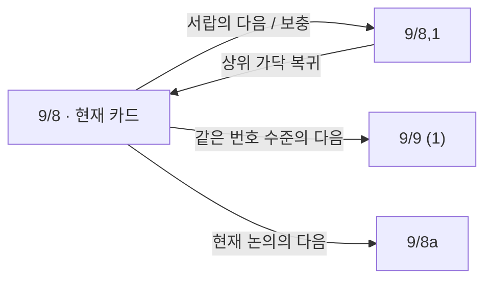

# 루만의 노트박스: 배열·참조·탐험, 그리고 디지털 도구

조사일: 2026-09-28. 작성: Codex의 자료 조사와 해석. 원자료·편집자 설명·브라우저 관찰을 구분한다. 역사 자료의 주된 근거는 Johannes F. K. Schmidt의 아카이브 개관이며, 전체 카드의 통계 분석이나 루만의 작업 재현 실험은 아니다. 출처와 주장 식별자는 [사례 장부](../cases/luhmann.md)에 정리했다.

## 1. 컬렉션을 어떻게 관리했는가

루만의 노트박스는 완성된 분류체계에 지식을 배치한 백과사전보다, 이미 적은 생각에 새로운 생각을 접속시키며 성장한 연구 작업물에 가깝다. 그렇다고 무질서한 카드 더미도 아니다. **안정된 주소, 국소적인 배열, 선택적인 색인, 횡단 참조**가 함께 작동한다. 이 네 가지는 서로 대체하지 않는다. [S01]

약 9만 장이라는 규모는 내용 노트만 센 수가 아니다. 내용 노트, 서지, 색인, 출판 계획 등 서로 다른 역할의 카드가 포함된다. 물리적으로는 27개 서랍에 해당하는 보관 단위가 있었고, 서랍 바깥에 주제 표지가 붙어 있지 않았다. 대부분 날짜 없는 A6 크기의 손글씨 카드다. 종이를 재사용한 경우도 있으므로 뒷면이 앞면의 논의를 잇는다고 가정할 수 없다. [S01]

관리의 핵심은 모든 카드에 제목·태그·유형을 부여하는 절차가 아니었다. 새 내용을 기존 논의 중 어느 지점에 이어 붙일지, 다른 곳의 어떤 생각과 연결할지, 나중에 어디로 들어가면 이를 다시 만날지를 결정하는 일이었다. 잘못된 길을 지우고 깨끗한 최종본만 남기기보다 후속 카드로 수정·확장하는 관행도 있었다. 이를 현대 소프트웨어의 자동 변경 이력과 동일시해서는 안 된다. [S01; 해석]

### 메모 유형: 종이의 역할과 지적 작업을 나누어 보기

| 원자료에서 구별되는 역할 | 무엇을 담는가 | 주의할 점 |
|---|---|---|
| 내용 노트, Notizzettel | 독서에서 발전시킨 생각, 개념, 논증, 질문, 반론, 자기 작업에 대한 성찰 | 독서 발췌를 곧바로 모두 넣은 것은 아니다. 독서 메모를 거쳐 다시 작성하는 과정이 설명된다 |
| 서지 카드, Bibliographiezettel | 저자·저작 정보, 독서·입수·작업 관련 표시; 일부 카드의 발췌와 노트 주소 | 시대에 따라 목록형과 저작별 카드형이 달라진다. 일관된 현대 서지 DB가 아니다 |
| 키워드 색인, Schlagwortregister | 표제어와 몇 개의 진입 카드 주소 | 해당 주제의 모든 카드 목록이 아니다 |
| 인명 색인 | 인물 이름과 관련 카드의 진입 주소 | 내용 노트나 서지와 다른 찾기 장치다 |
| 참조 집합·개요 카드 | 여러 논의로 향하는 주소와 짧은 설명, 논의의 갈래 | 모든 경우 독립된 물리적 카드 유형이라는 뜻은 아니다. 내용 노트가 이 역할도 수행한다 |
| 출판 계획·집필 개요 | 글의 구성, 출판을 위한 작업 계획 | 노트박스의 지속적 배열과 특정 원고의 순서는 구별된다 |

이 표는 아카이브 개관에 근거한 역할 구분이다. 현대 Zettelkasten 입문서의 ‘fleeting / literature / permanent note’를 루만이 동일한 이름·단계로 엄격히 운영했다고 역투사하지 않는다. 마찬가지로 ‘한 카드에 완전히 독립된 하나의 원자적 명제’가 전 카드의 규칙이었다고 단정할 근거도 없다. 이어지는 논의와 보충 카드가 실제로 존재한다. [S01–S02]

## 2. 정렬과 번호는 무엇을 의미하는가

### 전체 분류보다 국소적인 접속

큰 주제 구획은 있었지만 세부 내용의 위치는 완성된 주제 분류표로 결정되지 않았다. 기존 카드에서 더 생각할 지점이 생기면 그 뒤에 카드를 추가하고, 이미 후속 카드가 있으면 다시 분기할 수 있었다. 번호는 이 삽입을 허용하면서 기존 주소를 유지한다. [S01]

다음은 원리를 설명하는 도식이며, 특정 카드군을 전사한 목록은 아니다.

```text
1,1
  1,1a
    1,1a1
    1,1a2
      1,1a2a
      1,1a2b
  1,1b
1,2
```

번호의 계층처럼 보이는 부분은 생각이 삽입·연장된 자리의 흔적이다. 이를 ‘상위 개념 → 하위 개념’의 엄격한 존재론으로 읽으면 틀릴 수 있다. 안정된 번호는 찾아갈 주소이며, 그 숫자의 크기가 중요도나 작성 날짜를 뜻하지 않는다. 전체 재번호 매기기 없이 성장이 가능하다는 점이 중요하다. [S01]

### 서로 다른 세 가지 ‘다음’

| 질서 | 대답하는 질문 | 온라인 아카이브에서의 의미 |
|---|---|---|
| 물리적 배열 | 서랍에서 바로 옆 카드는 무엇인가? | 보관 순서를 따라가기. 생전 최종 배열을 완벽히 복원했다는 보장은 없다 |
| 번호상의 배열 | 같은 번호 수준의 다음 항목은 무엇인가? | 숫자·문자 구조의 한 수준을 따라 이동 |
| 내용상의 연결 가닥, Strang | 지금 읽는 논의가 어디서 계속되는가? | 편집자가 복원한 본줄기·삽입·보충·병렬 경로 |

실제 표본 **ZK II 9/8**에서 세 목적지는 달랐다. 서랍의 다음 카드는 **9/8,1**, 번호상 다음은 **9/9 (1)**, 현재 논의 가닥의 다음은 **9/8a**였다. 순서 하나만 재현해서는 이 차이를 보존할 수 없다. [S02; O01]

## 3. 태그·색인·링크·참조의 차이

### 키워드는 전수 분류보다 입구다

루만의 키워드 색인을 현대 앱의 태그와 가장 가까운 장치라고 설명할 수는 있다. 다만 동일한 기능은 아니다. 색인 표제어에는 보통 소수의 카드 주소가 붙고, 진입한 다음에는 배열과 참조를 따라 다른 내용을 만난다. 개관은 한 표제어의 주소가 대체로 최대 네 개라고 설명한다. ZK I은 약 1,250개 표제어, ZK II의 마지막 색인은 약 3,200개 표제어이며 후자는 여러 차례 갱신되었다. [S01]

현대의 `#사회` 검색은 그 태그를 단 항목들을 모을 수 있다. 루만의 색인은 ‘사회에 관한 모든 것’보다 ‘이 문제를 다시 생각하려면 여기서 시작하라’에 가깝다. 전자는 포함 여부를 계속 관리해야 하고, 후자는 좋은 진입점을 선정해야 한다. 둘 중 하나가 항상 우월하다는 결론은 아니다. 검색 목적과 관리 비용이 다르다. [해석]

### 참조는 모두 같은 화살표가 아니다

| 참조의 역할 | 원자료에서의 방식 | 디지털화할 때 잃기 쉬운 정보 |
|---|---|---|
| 가까운 보충 | 본문 위치의 붉은 숫자·문자와 보충 카드 | 본문의 어느 지점을 보충하는지 |
| 논의의 전개 | 인접·분기하는 번호와 내용의 연속 | 그저 관련 있는지, 다음 논증인지 |
| 먼 곳으로 연결 | 다른 주소를 직접 적음 | 왜 그 지점과 연결했는지 |
| 여러 갈래 안내 | 주소들을 모으고 짧은 설명을 붙임 | 선택된 경로의 목적과 구별 |
| 문헌 참조 | 저자·저작·쪽 등 서지적 지시 | 특정 판본·문장과 자기 해석의 경계 |

아카이브는 근거리 참조, 원거리 참조, 집합 참조와 때로 명시된 역참조를 설명한다. **A가 B를 가리켰다는 사실로 자동 계산한 backlink와, B에 루만이 직접 쓴 역참조는 다른 증거다.** 또 주소 링크가 있다고 해서 두 주장의 지지·반박·인용 관계까지 자동으로 정해지는 것은 아니다. [S01–S03; 해석]

서지 카드에서 내용 노트로 가는 주소 역시 체계적으로 모두 기록된 것은 아니다. 따라서 전체 시스템을 ‘출처 → 발췌 → 주장 → 출판’의 완전한 추적 그래프로 묘사할 수 없다. 주소의 안정성과 출처 계보의 완전성은 별개의 성질이다. [S01]

## 4. ZK I과 ZK II는 무엇이 질적으로 다른가

두 컬렉션은 한 박스의 단순한 앞·뒤 권이 아니다. 별도로 성장했고, 두 박스 사이의 참조도 많지 않다. 다음은 개관의 역사 설명을 요약한 것이며, 전 카드의 문체·링크 밀도를 직접 측정한 결과는 아니다. [S01]

| 비교 | ZK I | ZK II |
|---|---|---|
| 주된 형성 시기 | 대략 1952–1960년; 후속 추가가 있어 1960년 일괄 종료가 아님 | 1961–1997년 초 |
| 규모 | 약 22,000장 | 약 67,000장 |
| 연구·생활 맥락 | 행정 실무 시기, 법·행정·국가·철학 독서에서 조직·사회학 문제로 전개 | 하버드 체류와 학문 경력의 전개, 장기간의 사회학 이론 작업 |
| 큰 구획 | 108개 주제 구획, 크기가 매우 불균등 | 11개 넓은 구획, 내부에서 대규모 분기 |
| 내용의 성격 | 독서·문제 영역에 가까운 전개가 두드러짐 | 개념과 방법의 정교화, 이론 문제의 상호 연결이 중심적으로 드러남 |
| 서술 경향 | 초기에는 원전과 가까운 길고 연속적인 서술 | 시간이 흐르며 압축된 논지 형태가 강해짐; 모든 카드가 같지는 않음 |
| 서지 관리 | 저작들을 카드에 목록으로 적는 방식 | 초기 목록형에서 1960년대 중반 이후 저작별 카드 방식으로 확대 |
| 색인 | 약 1,250개 표제어 | 여러 판본을 거쳐 마지막 약 3,200개 표제어 |

ZK II의 11개 구획은 조직이론, 기능주의, 결정이론, 직무/관직(Amt), 공식·비공식 질서, 주권/국가, 개별 개념과 문제, 경제, 임시적 메모, 고대적 사회, 고도문화다. 이는 완성된 사회이론 교과서 목차가 아니다. 특히 ‘개별 개념과 문제’처럼 넓은 구획이 성장을 수용한다. [S01]

**질적 차이는 분류 규칙의 발명보다 연구 과업의 변화로 이해하는 편이 타당하다.** ZK I에서도 연결과 사고의 발전이 존재한다. ZK II만 ‘진짜 사고 도구’이고 I은 단순 발췌함이었다는 이분법은 과장이다. 반대로 같은 카드·번호를 썼다는 이유로 연구의 성숙, 압축된 표현, 장기 개념 작업의 차이를 지워서도 안 된다. [해석]

ZK II 시작은 하버드 체류 당시 첫 박스를 독일에 두고 간 사정과 연결된다. 이를 ‘I의 실패 때문에 시스템을 리셋했다’는 이야기로 바꾸지 않는다. ZK I에는 이후의 추가도 있으므로 두 기간은 완전히 끊어지지 않는다. [S01]

## 5. 온라인 노트박스를 탐험한다는 경험

### 실제로 따라간 작은 경로

출발점은 자기 노트박스에 대한 카드 [ZK II 9/8](https://niklas-luhmann-archiv.de/bestand/zettelkasten/zettel/ZK_2_NB_9-8_V)이다. 관찰 당시 포털 표시는 Version 25, 23.05.2026이었다.

1. **한 장을 읽는다.** 원고 이미지와 전사문을 함께 본다. 9/8은 질서와 무질서, 생각의 군집과 그때그때 실현되는 예측 불가능한 조합을 함께 다룬다. 찾기 장치와 내용의 구별도 적혀 있다. 이는 루만의 자기 설명이지 효과 검증 결과가 아니다.
2. **근처로 갔다가 다른 갈래임을 알아차린다.** 서랍의 다음 카드 버튼은 [9/8,1](https://niklas-luhmann-archiv.de/bestand/zettelkasten/zettel/ZK_2_NB_9-8-1_V)로 이어졌다. 여기서는 노트박스를 대화 상대·작업 파트너로 삼는 주제가 나온다. 원 카드의 붉은 `1`도 같은 보충 카드로 연결된다.
3. **상위 가닥으로 돌아간다.** 보충의 내용을 읽은 뒤 상위 가닥 이동으로 9/8에 복귀했다. 무조건 뒤로가기를 누르는 것과 달리 논의 구조를 따라 복귀할 수 있다.
4. **본문의 전개를 따라간다.** 현재 가닥의 다음 버튼으로 [9/8a](https://niklas-luhmann-archiv.de/bestand/zettelkasten/zettel/ZK_2_NB_9-8a_V)에 갔다. 이 카드는 생산성 문제를 노트박스와 사용자 사이의 관계로 설정한다.



위 도식은 관찰한 목적지와 이동을 재구성한 것이며 원고 자체의 그림이 아니다. 번호상 다음 목적지는 UI에서 확인했지만 이번 경로에서는 방문하지 않았다. 9/8a 전사는 읽었으나 해당 카드의 원고 이미지에는 일시적으로 표시 불가 메시지가 나왔다. 따라서 9/8a의 필적 대조까지 완료했다고 할 수 없다. [O01]

### 무엇을 경험하게 하는가

이 인터페이스는 책처럼 한 줄로 읽는 방식과 검색 결과 목록 사이에 다른 선택지를 만든다. 논의를 계속할지, 보충을 읽을지, 한 단계 돌아갈지 결정한다. 새 카드마다 국소 그래프가 재구성되어 현재 위치와 갈래를 보여 준다. **큰 그래프를 구경하는 것보다, 한 논의의 이웃을 읽고 경로를 선택하는 경험**에 가깝다. 이는 UI 구조에 대한 해석이며 사용자의 몰입도나 학습 효과를 측정한 평가는 아니다. [S02; O01]

다음 장치들도 구별해야 한다.

- **원고와 전사:** 필적·덧붙임·지면의 흔적을 볼 수 있고 읽기 쉬운 전사와 대조할 수 있다.
- **내용 개요:** 진입에 유용하지만 상세한 계층 전체를 루만이 만든 목차로 착각하면 안 된다. 편집자가 내용을 정리한 부분이 있다.
- **국소 시각화:** 삽입·보충·병렬 가닥과 뒷면 등을 구분한다. 전체 카드의 모든 횡단 참조를 펼친 전역 네트워크가 아니다.
- **검색·색인:** 아직 어디로 갈지 모를 때 진입한다. 전사된 텍스트에 대한 검색 범위와 실제 자료 전체는 같지 않다.
- **서지 포털:** 통합된 문헌 정보와 링크는 연구에 유용하지만 당시 종이 서지 체계 그 자체는 아니다.

### 아카이브 경험과 루만의 작업 경험은 다르다

우리는 완성된 뒤 남은 자료와 편집자의 복원을 탐험한다. 루만은 새 카드를 작성하고 넣을 위치를 정하며 자기 박스를 바꾸었다. 공개 열람에서 할 수 있는 ‘다음 카드로 이동’은 그가 했던 ‘새로운 다음 카드를 만들기’의 일부 조건만 보여 준다.

전사도 완전한 사진 복제가 아니다. 편집 원칙에 따라 구두점이나 명백한 오류가 정리되고, 일부 주변부 추가가 각주 위치로 옮겨지며, 원고의 색과 화면 링크 색이 달라진다. 원고의 번호, 편집 식별자, 스캔 식별자 역시 구별된다. 사후 운반 과정 때문에 생전 최종 물리 배열을 완전히 복원하기 어렵다는 개관의 한계도 있다. [S01–S03]

## 6. Obsidian은 외형만 재현하는가

**제품 자체를 그렇게 단정할 근거는 없다.** 현재 공식 문서에는 파일·제목·블록 링크, backlink 문맥 표시, 링크하지 않은 언급, 임베드, 일일 노트, 로컬 그래프, Canvas가 있다. Canvas에서는 연결선에 방향과 라벨을 줄 수도 있다. ‘Obsidian에는 문맥이나 블록 참조가 없다’는 비판은 사실과 다르다. 이번 조사는 공식 문서 기준이며 로컬 vault의 작성 실험은 하지 않았다. [O-S01–O-S07]

다만 다음처럼 사용하면 루만의 실천 중 중요한 부분이 사라질 수 있다. 이것은 **기능 부재와 사용 관행의 실패를 나누어 봐야 할 문제**다.

| 표면적인 재현 | 빠지는 작업 | Obsidian에서도 가능한 보완 |
|---|---|---|
| 짧은 파일과 고유 ID를 많이 만듦 | 원문을 자기 문제로 다시 서술하기 | 출처와 자기 판단을 나누고 질문·반례·후속 논지를 적기 |
| 관련 단어마다 링크를 붙임 | 왜 관련되는지, 다음 논증인지 구별 | 링크 주변 문장에 연결 이유를 쓰고 개요 노트에 경로를 구성 |
| 전역 그래프의 밀도를 성장 지표로 삼음 | 실제 읽기·비교·논증의 진전 | 로컬 그래프와 backlink 문맥을 읽고 결과 글에서 사용 여부 점검 |
| 파일을 한 주제 폴더에만 배치 | 한 생각을 다른 문제에서 다시 만날 경로 | 여러 진입용 노트와 링크를 만들기 |
| 원문을 저장·태깅한 것으로 연구를 마침 | 재독, 비교, 수정, 집필 | 검토와 글쓰기에서 노트를 다시 만나도록 작업을 설계 |

기본 그래프의 선은 내부 링크를 시각화한다. 선 하나만 보고 ‘근거’, ‘반례’, ‘시간적 후속’을 알 수는 없다. 하지만 사용자가 본문이나 Canvas 라벨에 뜻을 적을 수 있으므로 이는 모든 표현의 불가능성이 아니라 **기본 시각화가 자동으로 보존하지 않는 의미**다. [O-S04, O-S07; 해석]

Obsidian의 파일 안 블록 주소는 `[[파일#^블록ID]]` 형태다. Roam의 블록 참조와 비교할 때 조작의 중심이 다르지만, 파일 중심이라는 이유만으로 사고가 파일 안에 갇힌다고 결론 내릴 수 없다. 또 블록을 다른 파일로 옮길 때의 참조 보존 등 세부 동작은 이번에 실행 검증하지 않았다. [O-S01]

## 7. Roam Research에서 더 돋보이는 것은 무엇인가

### 루만 영향설의 확인 범위

공식 도움말에는 Zettelkasten 자료 묶음과 Conor White-Sullivan의 「Live Zettling on Roam」이 연결되어 있다. 제작자 측이 이 실천과 관계를 맺고 소개했다는 근거다. 다만 이번에 읽은 백서와 도움말만으로 제품의 각 기능이 루만에게서 직접 유래했다는 설계 계보까지 입증할 수는 없다. 동영상 전편의 발언 분석도 수행하지 않았다. [R-S01–R-S04]

Roam 백서는 겹치는 계층과 작은 단위의 재사용을 지향한다. Engelbart 등의 선행 작업도 거론한다. 더구나 백서 자체가 2017/18년 겨울에 쓰였으며 일부 추론·논증 분석 구상은 우선순위가 낮아졌다고 설명한다. 백서의 장기 비전을 현재 자동 추론 기능으로 소개하면 안 된다. [R-S01]

### 두드러지는 상호작용

| 특징 | 실제로 달라지는 일 | 루만과 비교할 때의 의미 |
|---|---|---|
| 블록 참조 `((…))` | 문서 전체보다 작은 텍스트 단위를 다른 곳에서 참조하고 원래 위치로 돌아갈 수 있음 | 주소의 대상을 종이 한 장에서 세부 작업 단위로 세분화 |
| 블록 임베드 | 원본을 여러 문맥에서 보여 주고 편집을 연결할 수 있음 | 한 내용을 여러 집필 맥락에 놓되 동일성을 유지하는 기능 |
| 문맥을 포함한 Linked References | 어느 페이지의 어떤 계층에서 해당 대상을 언급했는지 모아서 봄 | 직접 고른 소수 진입점과 달리 참조를 역으로 수집하는 장치 |
| 태그와 페이지 참조의 통합 | `#주제`는 별도 분류 객체라기보다 표시 방식이 다른 페이지 참조 | 태그를 누른 곳이 다시 내용을 쓰고 참조를 모으는 페이지가 됨 |
| 원본·참조·복사·별칭의 선택 | 같은 내용을 유지할지, 수정 가능한 별도 초안으로 만들지 선택 | ‘재사용’이 하나의 동작이 아니라 여러 관계임을 드러냄 |

블록 참조 설명 페이지에서는 원래 문맥으로 이동하거나 사이드바에 여는 방법, 임베드, 단순 텍스트 복사, 별칭, `text and alias`가 구별된다. 특히 마지막은 **수정 가능한 복사본과 원본으로 향하는 링크**를 함께 남긴다. 원본과 계속 동기화되는 참조와 다르다. 독서 문장을 자기 초안으로 바꿀 때 이 차이는 중요하다. [R-S02]

공개 도움말 그래프를 실제로 열었을 때, 설명 아래의 Linked References에는 다른 페이지의 출처 제목과 상위 문맥, 해당 블록이 함께 표시되었다. 태그 도움말도 직접 열어 `#`가 페이지 참조의 다른 표시라는 설명을 확인했다. 편집·이동·동기화는 도움말의 설명을 확인한 것이며 공개 그래프를 수정해서 시험하지 않았다. [O02; R-S02–R-S03]

일일 노트에서 작성하고 관련 주제 페이지에서 다시 모아 보는 사용법 역시 주목할 수 있다. 그러나 일일 노트, backlink, 임베드 각각은 Roam만의 독점적인 발명이거나 현재의 독점 기능이 아니다. 차이는 **블록·아웃라인·참조된 문맥을 중심으로 작업을 이어 가는 기본 상호작용의 결합**에 있다. Roam이 모든 연구 작업에서 Obsidian보다 우수하다는 실험 결과는 아니다. [R-S02; O-S02, O-S05–O-S06; 해석]

### Roam도 자동으로 해결하지 못하는 것

자동 backlink는 무엇이 참조했는지를 보여 준다. 왜 중요한지, 올바른 인용인지, 반박이 반영됐는지를 보증하지 않는다. 임베드의 최신 내용이 바뀌면 예전에 읽고 판단했던 문장을 그대로 인용한 것인지 별도 확인이 필요하다. 원문 참조가 남아도 변형 이유와 작성 시점까지 기록되는 것은 아니다. 블록 수와 참조 수가 커져도 선택·요약·논증의 일은 남는다. [기능에서 도출한 한계; 실제 실패율 미측정]

## 8. 이 연구에서 가져갈 질문

루만에게서 가져올 만한 것은 번호 모양보다 다음 질문이다.

1. 새 기록을 어느 기존 논의에 접속시키며, 그 이유가 남는가?
2. 소수의 좋은 진입점과 전수 검색을 구별해 지원할 수 있는가?
3. 같은 내용의 참조·복사·변형·인용을 사용자가 구별할 수 있는가?
4. 읽던 맥락을 잃지 않고 다른 갈래를 탐색한 뒤 복귀할 수 있는가?
5. 기록이 다시 쓰이거나 반박될 때, 이전 판단과 출처를 확인할 수 있는가?

na에는 이 질문들을 실험 가설로 남긴다. Block 제목·태그·유형의 의무화, 루만 번호의 강제, 그래프 화면의 우선 구현으로 바로 옮기지 않는다. 현재 수동 daily log라는 출발점과도 양립할 수 있는 질문들이다.

후속 실험은 같은 자료와 질문으로 ‘저장만 한 묶음’, ‘이유를 쓴 연결과 진입점을 갖춘 묶음’을 비교할 수 있다. 일정 기간 뒤 근거 찾기, 반론 찾기, 짧은 글 작성에 걸리는 시간과 출처 오류, 새 연결의 설명 가능성을 본다. **이는 제안이며 수행 결과가 아니다.** 먼저 ZK I·II에서 동일 주제의 카드군을 더 읽어 이번 개관 중심 해석의 반례를 찾는 작업이 필요하다.

## 출처

### 루만 아카이브

- **S01** Johannes F. K. Schmidt, [Zettelkasten 개관](https://niklas-luhmann-archiv.de/nachlass/zettelkasten): 역사, 구성, 번호, 색인, 참조에 대한 편집자 연구 설명.
- **S02** [Zettelkasten 튜토리얼](https://niklas-luhmann-archiv.de/bestand/zettelkasten/tutorial): 전사·검색·배열·가닥 탐색 원칙. 기능의 공개 상태에 관한 일부 설명은 페이지 안에서도 차이가 있어 현재 UI와 구별했다.
- **S03** [모델·API 문서](https://niklas-luhmann-archiv.de/projekt/dokumentation), [TEI 모델 상세](https://niklas-luhmann-archiv.de/assets/odd-doku/luhmann.html): 디지털 편집 표현과 데이터 접근.
- **S04** 루만, [ZK II 9/8](https://niklas-luhmann-archiv.de/bestand/zettelkasten/zettel/ZK_2_NB_9-8_V), [9/8,1](https://niklas-luhmann-archiv.de/bestand/zettelkasten/zettel/ZK_2_NB_9-8-1_V), [9/8a](https://niklas-luhmann-archiv.de/bestand/zettelkasten/zettel/ZK_2_NB_9-8a_V): 원자료의 디지털 편집본. 날짜 미상. 편집자는 9/8 묶음 상당 부분을 1980/81년 집필과 관련된 것으로 추정한다. 확정 작성일로 사용하지 않았다.

### Obsidian 공식 도움말

- **O-S01** [Links](https://obsidian.md/help/links).
- **O-S02** [Backlinks](https://obsidian.md/help/plugins/backlinks).
- **O-S03** [Tags](https://obsidian.md/help/tags).
- **O-S04** [Graph view](https://obsidian.md/help/plugins/graph).
- **O-S05** [Embeds](https://obsidian.md/help/embeds).
- **O-S06** [Daily notes](https://obsidian.md/help/plugins/daily-notes).
- **O-S07** [Canvas](https://obsidian.md/help/plugins/canvas). 텍스트 전용 Canvas 카드는 파일로 전환하기 전 backlink에 나타나지 않는다는 경계도 명시되어 있다.

### Roam 공식 자료와 관찰

- **R-S01** [White Paper](https://roamresearch.com/#/app/help/page/dZ72V0Ig6): 설계 비전, 작성 시기·우선순위에 대한 자체 설명 포함.
- **R-S02** [Block References](https://roamresearch.com/#/app/help/page/l8uKkdhbc): 참조·임베드·복사·별칭과 원래 문맥으로의 이동. 본문 설명과 하단 커뮤니티 자료는 구별했다.
- **R-S03** [Tags](https://roamresearch.com/#/app/help/page/nXhOWmKXo): 태그와 페이지 참조의 관계.
- **R-S04** Conor White-Sullivan, [Live Zettling on Roam](https://www.youtube.com/watch?v=ScRrcL__SSI): 공식 도움말이 Roam Team Videos로 연결한 자료. 연결 사실만 확인했으며 동영상 전편 분석 근거로 쓰지 않았다.
- **O01** 2026-09-28 브라우저 관찰: §5의 세 목적지와 보충→복귀→본가닥 이동. 원고·전사·메타데이터·다운로드 링크 확인.
- **O02** 같은 날 Roam 공개 help 그래프 열람: 백서, Block References, Tags; Linked References의 출처 문맥 확인. 외부 데이터 변경 없음.
